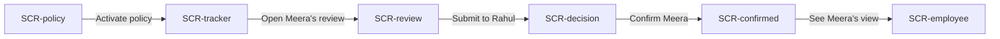

# Spec: Confirmation — probation to confirmed

> Condensed from the feature spec agreed in this session. Scope for this run is the **hero flow only** (flow mockup, not a working model).

## Problem statement
HR tracks probation in spreadsheets and chases managers by email, so confirmations slip past their due date, feedback is inconsistent, and the status change, letter and follow-up tasks are all manual. Confirmation tracks every probation, starts the review on time, routes it through reviewers with a structured evaluation, and turns the final decision into the status change, the letter and the follow-up tasks.

## Goals / Non-goals
**Goals**
- No confirmation starts late: reviews open automatically before the due date (O1).
- Every review ends in one of three explicit outcomes: confirm, extend, do not confirm (O2).
- Reviews are comparable: one evaluation form per policy (O3).
- The decision does the paperwork: status, notice period, letter, eligibility, tasks (O4).
- The employee sees the outcome and feedback in one place (O5).

**Non-goals (this run)**
- Extension and do-not-confirm branches as separate screens, settings, mobile, empty/error/loading states.

## Success metrics
- Share of confirmations decided on or before the due date (target: over 90%).
- Median days from review start to decision (target: under 7).
- Confirmations needing manual HR follow-up after the decision (target: under 5%).

## Personas
- **Priya Nair** — HR admin at Northwind Components Pvt Ltd.
- **Divya Menon** — Design Lead, Meera's reporting manager (reviewer level 1).
- **Rahul Mehta** — Head of HR (final reviewer, letter signatory).
- **Meera Iyer** — Product Designer, joined 1 Jul 2026, probation ends 30 Oct 2026.

## Use cases
- **UC1 — Admin sets the policy.** Priya opens "Probation — Full-time staff": 120 days for staff (90 for interns by category), 2 reviewer levels (reporting manager → Head of HR), start 15 days before due, auto-forward after 3 days, at most 2 extensions, evaluation form with 4 ratings. Activates it.
- **UC2 — Admin tracks the pipeline.** Priya sees 18 on probation, 6 due in 30 days, 1 overdue, extension rate 11%; reviews started automatically. Opens Meera's.
- **UC3 — Manager reviews.** Divya rates Meera on 4 criteria, picks Confirm, writes feedback Meera will see and a private remark, submits.
- **UC4 — Final reviewer decides.** Rahul sees Divya's ratings and recommendation, the timeline and the effective date, clicks Confirm.
- **UC5 — Decision does the paperwork.** Status Probation → Confirmed; notice period 30 → 60 days; confirmation letter generated and signed; leave eligibility updated; tasks raised for payroll and IT.
- **UC6 — Employee sees the outcome.** Meera sees "Confirmed from 30 Oct 2026", Divya's feedback, and acknowledges the letter.

## Key functionalities
| ID | Feature | Priority | UC | Opportunity |
|---|---|---|---|---|
| K1 | Probation period by employee category | P0 | UC1 | O1 |
| K2 | Reviewer levels with auto-forward | P0 | UC1, UC4 | O1 |
| K3 | Auto-start N days before due; extension cap | P0 | UC1, UC2 | O1 |
| K4 | Evaluation form per policy | P0 | UC1, UC3 | O3 |
| K5 | Probation tracker with due / overdue / extension counts | P0 | UC2 | O1 |
| K6 | Three outcomes: confirm, extend, do not confirm | P0 | UC3, UC4 | O2 |
| K7 | Feedback for employee vs. private remarks | P0 | UC3 | O5 |
| K8 | Final decision with previous level's context and timeline | P0 | UC4 | O2 |
| K9 | Automatic post-decision actions (status, notice, letter, eligibility, tasks) | P0 | UC5 | O4 |
| K10 | Employee outcome view with letter acknowledgement | P0 | UC6 | O5 |

## User flows
### F1 — From probation to confirmed (hero flow)

| Step | Screen | User action | System response |
|---|---|---|---|
| F1.S1 | SCR-policy | Priya reviews the policy, clicks Activate policy | Policy live, opens the tracker |
| F1.S2 | SCR-tracker | Clicks Meera Iyer's card in "Manager review" | Opens Divya's review of Meera |
| F1.S3 | SCR-review | Divya keeps Confirm selected, clicks Submit to Rahul | Sent to level 2, opens Rahul's decision |
| F1.S4 | SCR-decision | Rahul clicks Confirm Meera | Decision recorded, opens the result |
| F1.S5 | SCR-confirmed | Automatic actions tick through; Priya clicks See Meera's view | Opens Meera's view |
| F1.S6 | SCR-employee | Meera clicks Acknowledge letter | Status turns Acknowledged |

## Screen inventory
| Screen | Purpose | Key content | States |
|---|---|---|---|
| SCR-policy | Set the confirmation policy | Probation by category, reviewer levels, timing (start before due, auto-forward, extension cap), evaluation criteria, outcomes, Activate policy | default |
| SCR-tracker | Track every probation | Stats (on probation, due in 30 days, overdue, extension rate), board by stage with cards and due dates, Meera's card | default |
| SCR-review | Manager evaluation | Employee summary, 4 ratings, outcome choice (confirm / extend / do not confirm), feedback for Meera, private remarks, Submit | default |
| SCR-decision | Final reviewer decision | Divya's recommendation and ratings, timeline, effective date, Confirm / Extend / Do not confirm | default |
| SCR-confirmed | What the decision did | Confirmed banner, checklist of automatic actions with before → after, See Meera's view | default |
| SCR-employee | Employee outcome | Status card, manager feedback, confirmation letter with Acknowledge | default |

## Edge cases & error handling
Out of scope for this flow mockup.

## Open questions
None for this run.
