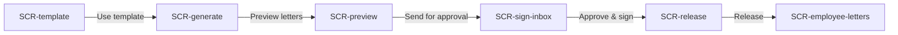

# Spec: Letters — HR letter generation

> Condensed from the feature spec agreed in this session. Scope for this run is the **hero flow only** (flow mockup, not a working model).

## Problem statement
HR issues letters by editing Word files by hand, chasing signatures over email and sending PDFs one at a time. Letters turns one template into personalised, signed letters for many employees and delivers them to the employee portal for acknowledgement.

## Goals / Non-goals
**Goals**
- One template, many letters: merge fields fill each employee's data (O1, O3).
- One guided path from template to signed, released letter (O2).
- Signing happens in the signatory's inbox (O4).
- Employees receive, keep and acknowledge letters in one place (O5).

**Non-goals (this run)**
- Template file upload, employee letter requests, multi-level reviewers, PFX setup, mobile app, analytics, settings, empty/error/loading states.

## Success metrics
- Median time from "prepare" to "released" for a batch (target: under 1 day).
- Letters needing manual correction after release (target: under 1%).
- Share of released letters acknowledged within 3 days (target: over 90%).

## Personas
- **Priya Nair** — HR admin at Northwind Components Pvt Ltd. Runs the annual increment cycle.
- **Rahul Mehta** — Head of HR, authorised signatory.
- **Asha Rao** — Senior Engineer, Bengaluru. Receives her increment letter.

## Use cases
- **UC1 — Admin sets up a template.** Actor: Priya. Main path: opens "Annual increment letter", sees body text with merge fields, number series `NW/INC/2026/####`, and "Employee must: Acknowledge". Outcome: template ready.
- **UC2 — Admin generates letters in bulk.** Actor: Priya. Main path: picks template, approval type "Signatory approval", signatory Rahul Mehta, filter "Engineering · Bengaluru" (24 employees). Outcome: batch of 24 drafts.
- **UC3 — Admin previews and sends for approval.** Actor: Priya. Main path: flips through merged letters (Asha Rao shown), clicks Send for approval. Outcome: batch pending with Rahul.
- **UC4 — Signatory signs.** Actor: Rahul. Main path: opens his Letter signature inbox, previews, clicks Approve & sign. Outcome: signature applied to all 24 letters.
- **UC5 — Admin releases.** Actor: Priya. Main path: chooses publish to employee portal, email as password-protected PDF, require acknowledgement; clicks Release. Outcome: letters delivered.
- **UC6 — Employee acknowledges.** Actor: Asha. Main path: opens Documents › Letters, reads the signed letter, clicks Acknowledge. Outcome: status Acknowledged, download available.

## Key functionalities
| ID | Feature | Priority | UC | Opportunity |
|---|---|---|---|---|
| K1 | Template editor with merge fields | P0 | UC1 | O1 |
| K2 | Letter number series | P0 | UC1 | O1 |
| K3 | Employee action setting (acknowledge / accept-reject) | P0 | UC1, UC6 | O5 |
| K4 | Bulk generation by employee filter | P0 | UC2 | O3 |
| K5 | Approval type incl. "no approval needed" | P0 | UC2 | O2 |
| K6 | Per-letter merged preview | P0 | UC3 | O3 |
| K7 | Signatory inbox with approve & sign | P0 | UC4 | O4 |
| K8 | Release options: portal, email, password PDF, require acknowledgement | P0 | UC5 | O5 |
| K9 | Employee document center with acknowledge | P0 | UC6 | O5 |

## User flows
### F1 — Increment letters from template to acknowledgement (hero flow)

| Step | Screen | User action | System response |
|---|---|---|---|
| F1.S1 | SCR-template | Priya reviews the template, clicks Use template | Opens Generate letters with the template chosen |
| F1.S2 | SCR-generate | Picks approval type, signatory and the "Engineering · Bengaluru" filter, clicks Preview letters | Creates 24 drafts, opens Preview |
| F1.S3 | SCR-preview | Steps to the next letter, clicks Send for approval | Batch sent to Rahul, opens his inbox |
| F1.S4 | SCR-sign-inbox | Rahul clicks Approve & sign | Signature stamped on the letter, opens Release |
| F1.S5 | SCR-release | Priya keeps portal + email + password + acknowledgement on, clicks Release 24 letters | Letters delivered, opens Asha's documents |
| F1.S6 | SCR-employee-letters | Asha clicks Acknowledge | Status turns Acknowledged |

## Screen inventory
| Screen | Purpose | Key content | States |
|---|---|---|---|
| SCR-template | Show a reusable template | Letter body with highlighted merge fields, merge-field side panel, number series, employee action, Use template | default |
| SCR-generate | Set up a bulk run | Template, approval type options, signatory, employee filter chip, 24 matched employees list, Preview letters | default |
| SCR-preview | Check merged letters | Rendered letter for Asha Rao with real values, "Letter 1 of 24" pager, Send for approval | default |
| SCR-sign-inbox | Signatory approves and signs | Inbox list (1 batch, 24 letters), letter preview, timeline, Approve & sign / Reject | default |
| SCR-release | Release signed letters | Batch summary (24 signed), toggles: publish to portal, email PDF, password protect, require acknowledgement; Release | default |
| SCR-employee-letters | Employee receives the letter | Documents › Letters list, signed letter preview, Acknowledge / Download | default |

## Edge cases & error handling
Out of scope for this flow mockup.

## Open questions
None for this run.
