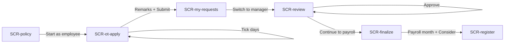
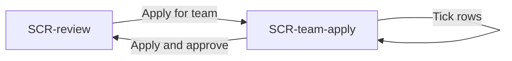
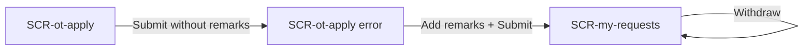

# Spec: Overtime — from attendance to payslip

## Problem statement
Overtime in shift-heavy businesses is tracked in spreadsheets and chat. Hours are missed or padded, caps aren't enforced, and payroll corrects past months by hand. Overtime turns extra time already captured in attendance into policy-checked, approved, payroll-ready pay.

## Goals / Non-goals
**Goals**
- Employees never type hours: eligible OT is computed from attendance by the policy (O1).
- Managers approve in one place and can apply for team members without app access, with caps enforced (O2).
- Admins decide which payroll month pays approved OT; late hours become arrears, corrections become reversals (O3).
- The policy reads as plain language on one card (O4).

**Non-goals**
- Editing or assigning policies, comp-off, multi-level workflows, pre-approval of planned OT, mobile app.

## Success metrics
- Share of OT paid without manual payroll correction (target: >95%).
- Median time from OT worked to approval (target: <2 days).
- Over-cap OT paid (target: 0).

## Personas
- **Asha Rao** — employee, Paint shop, Basic ₹26,000/month. Wants to see and claim what she's earned.
- **Vikram Shah** — line manager and reviewer for Asha, Ravi, Meena and Joseph.
- **Priya** — HR / payroll admin. Owns the policy and payroll.

## Default policy (fixed for this product run)
"Plant overtime policy": break deducted 15 min on rest days and holidays (0 on regular days); minimum to qualify 30 min on regular days, 60 min otherwise; 15-minute blocks, rounded down; caps 4:00 h a day and 20:00 h a month; pay = Basic ÷ 208 h × 2 (× 3 on holidays). Sample data and rules: `src/lib/overtime-demo.ts`.

## Use cases
- **UC1 — Employee claims OT.** Actor: Asha. Trigger: she worked past her shift. Main path: opens Apply, sees eligible hours per day, ticks days, adds remarks, submits. Alternate: submits without remarks → error; selection would exceed monthly cap → error; day below minimum → can't be selected. Outcome: requests pending with her manager.
- **UC2 — Manager reviews OT.** Actor: Vikram. Trigger: requests in his queue. Main path: reads hours, amount and reason, approves or rejects with optional remarks. Alternate: queue empty. Outcome: requests approved or rejected.
- **UC3 — Manager applies for the team.** Actor: Vikram. Trigger: team members without app access worked OT. Main path: opens Apply for team, ticks eligible rows, applies. Alternate: rows that would cross the monthly cap are shown in pink and can't be selected. Outcome: OT approved for those days.
- **UC4 — Admin finalizes OT for payroll.** Actor: Priya. Trigger: payroll month closing. Main path: selects approved records, picks the payroll month, clicks Consider. Alternate: Ignore a record. Outcome: records land in that month's register as regular or arrear lines.
- **UC5 — Admin reviews the register.** Actor: Priya. Main path: sees total hours, payable, arrears and reversals, and each line's type.
- **UC6 — Employee withdraws a request.** Actor: Asha. Main path: on My requests, clicks Withdraw on a pending request. Outcome: request withdrawn.

## Key functionalities
| ID | Feature | Priority | UC | Opportunity |
|---|---|---|---|---|
| K1 | Readable default policy card | P0 | UC1–UC5 | O4 |
| K2 | Eligible OT computed per day from attendance (break → minimum → rounding → daily cap) | P0 | UC1, UC3 | O1 |
| K3 | Monthly cap balance and over-cap blocking | P0 | UC1, UC3 | O2, O5 |
| K4 | Submit with mandatory remarks and per-day reasons | P0 | UC1 | O5 |
| K5 | Manager approve / reject with remarks | P0 | UC2 | O2 |
| K6 | Manager apply for team | P0 | UC3 | O2 |
| K7 | Finalization into a payroll month (Consider / Ignore) | P0 | UC4 | O3 |
| K8 | Register with regular / arrear / reversal lines and totals | P0 | UC5 | O3 |
| K9 | Withdraw a pending request | P1 | UC6 | O5 |
| K10 | Persona switcher (employee / manager / admin) for the demo | P1 | UC1–UC5 | — |

## User flows

### F1 — Overtime from request to payroll (hero flow)

| Step | Screen | User action | System response |
|---|---|---|---|
| F1.S1 | SCR-policy | Reads the policy card, clicks "Start as employee" | Opens Apply for OT as Asha |
| F1.S2 | SCR-ot-apply | Ticks 3 Oct and 4 Oct | Selected total (6:15 h) updates against the 20:00 h monthly cap |
| F1.S3 | SCR-ot-apply | Types remarks, clicks Submit | Creates 2 pending requests, shows My requests |
| F1.S4 | SCR-my-requests | Clicks "Switch to manager" | Opens Vikram's review queue |
| F1.S5 | SCR-review | Clicks Approve on Asha's 3 Oct request | Request moves to Closed as Approved; queue count drops |
| F1.S6 | SCR-review | Clicks "Continue to payroll" | Opens Finalize as Priya |
| F1.S7 | SCR-finalize | Selects approved records, keeps October 2026, clicks Consider | Records move into the October register; a September record is typed Arrear |
| F1.S8 | SCR-register | Reviews totals and line types | Shows total hours, payable, arrears and a reversal line |

### F2 — Manager applies for the team

| Step | Screen | User action | System response |
|---|---|---|---|
| F2.S1 | SCR-review | Clicks "Apply for team" | Opens team list with eligible OT per day |
| F2.S2 | SCR-team-apply | Ticks eligible rows | Row that would cross Joseph's 20:00 h cap is pink, labelled "Over monthly cap", and can't be ticked |
| F2.S3 | SCR-team-apply | Clicks "Apply and approve selected" | Creates approved OT for ticked rows and returns to the review queue |

### F3 — Employee fixes an error and withdraws

| Step | Screen | User action | System response |
|---|---|---|---|
| F3.S1 | SCR-ot-apply | Ticks a day, clicks Submit with no remarks | Error state: "Remarks are required." |
| F3.S2 | SCR-my-requests | Clicks Withdraw on a pending request | Request moves to History as Withdrawn |

## Screen inventory
| Screen | Purpose | Key content | States |
|---|---|---|---|
| SCR-policy | Show the default policy before the flow | Policy name, five rule tiles, persona switcher, "Start as employee" | default |
| SCR-ot-apply | Employee claims OT | Stats (clocked extra 16:58 h, applied/approved, monthly cap left), table of days with day type, clocked extra, eligible OT, reason input; below-minimum day disabled; remarks; Submit | default, empty, error |
| SCR-my-requests | Employee tracks requests | Tabs Pending / History; rows with date, hours, reason, status; Withdraw | default, empty |
| SCR-review | Manager's queue | Tabs To review / Closed / Apply for team; cards with name, dept, date, day type, hours, ₹ amount, reason, remarks, Reject / Approve; "Continue to payroll" | default, empty |
| SCR-team-apply | Manager applies for team | Table of team members' eligible days; over-cap row pink; select all; "Apply and approve selected" | default |
| SCR-finalize | Admin finalizes approved OT | Payroll month select, Ignore / Consider; table with employee, date, day type, hours, rate, amount, type (Regular / Arrear) | default, empty |
| SCR-register | Admin reviews the payroll register | Totals: hours, payable, arrears, reversals; lines with type chips incl. a reversal for Ravi Kumar (14 Sep, −1:00 h) | default, empty |

## Edge cases & error handling
- Day below the minimum: shown, eligible "—", "Below minimum", not selectable.
- Submit with no day ticked: "Select at least one day."
- Submit with no remarks: "Remarks are required."
- Selection over the monthly cap: "That's over your monthly cap of 20:00 h. Pick fewer days."
- Manager apply over cap: row pink and disabled.
- Finalize with nothing selected: "Select at least one record."

## Open questions
- None for this run.
