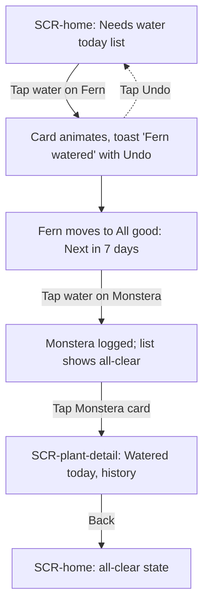
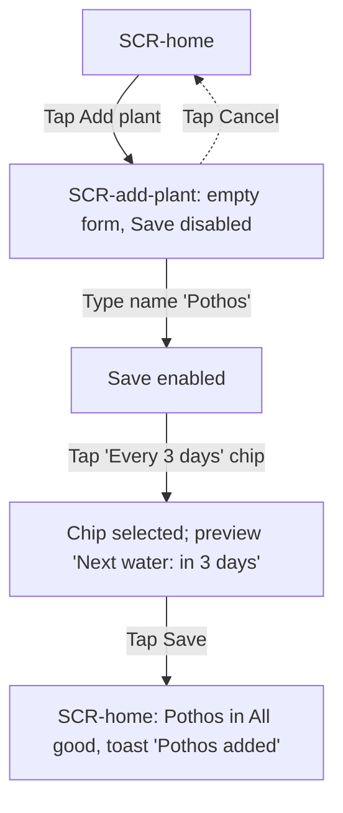

# Spec: Sprout — houseplant watering tracker

## Problem statement
Casual plant owners with 3–15 indoor plants forget when each plant was last watered. They water on a whim, so plants get drowned or dried out; overwatering is a top killer (research: Problem summary). Existing apps bury the answer under care guides, setup quizzes and paywalls. Sprout answers one question the moment it opens: **which plants need water today?** Logging a watering takes one tap.

## Goals / Non-goals
**Goals**
- Show what needs water today, and nothing else, on open (O1).
- Log a watering in one tap and restart that plant's countdown (O2).
- Add a plant in seconds with just a name and an interval (O3).
- Free, unlimited, no account (O4).
- Help avoid overwatering by showing when a plant is *not* due yet (O5).

**Non-goals**
- Accounts, sign-in, sync, social features (brief: out of scope).
- Camera plant identification, species care database.
- Push notifications or any backend. Data lives in browser local storage.
- Snooze / "check soil" action (see Decisions).
- Streaks, photos, care guides.

### Decisions on research open questions
- **Interval source:** user-set, with presets. Add-plant offers chips for *Every 3 days*, *Weekly* (default) and *Every 2 weeks*, plus a *Custom* stepper (1–30 days). No species presets: they need data work and slow setup.
- **Snooze / check soil:** left out. It would need its own action and state, which doesn't fit 4 screens / 2 flows. Overwatering is addressed instead (O5): plants that aren't due show "Next in N days" on the home list, so the user can see at a glance not to water them.
- **Overdue plants:** they stay in the "Needs water today" list, sorted most overdue first, with a warm amber tag ("2 days late"). No separate screen or section.

## Success metrics
(Concept-level, for a portfolio piece; there is no analytics backend.)
- Time from opening the app to logging a watering: under 3 seconds (one tap).
- Time to add a plant: under 15 seconds, 2 required inputs.
- In a usability test, 5 of 5 users can say which plants need water within 5 seconds of opening.
- Zero required fields beyond name and interval.

## Personas
**Busy Maya** (from research). Late 20s, rents an apartment, 6 plants from gifts and impulse buys. Wants them alive without making it a hobby. Job to be done: *"When I walk past my plants, tell me which ones need water now, so I don't drown or forget any of them."*

## Use cases
**UC1 — Water what's due today**
- **Actor:** Maya
- **Trigger:** She opens Sprout while walking past her plants.
- **Main path:** She sees the "Needs water today" list, waters a plant, taps its water button. The plant moves to "All good" with "Next in 7 days".
- **Alternate paths:** (a) Nothing is due: an all-clear message shows. (b) She tapped by mistake: she taps *Undo* in the toast. (c) A plant is overdue: it sits at the top with a "N days late" tag. (d) She wants to check one plant: she taps its card to see when it was last watered.
- **Outcome:** The plant's last-watered date is today and its countdown restarts.

**UC2 — Add a new plant**
- **Actor:** Maya
- **Trigger:** She brings home a new plant, or is setting up Sprout for the first time.
- **Main path:** She taps *Add plant*, types a name, picks an interval chip, optionally sets "Last watered" (default today) and saves. She returns home and sees the new plant in the list.
- **Alternate paths:** (a) Name left blank: Save stays disabled with a hint. (b) An unusual interval: she picks *Custom* and steps to the number of days. (c) She hasn't watered it yet: she sets "Last watered" to a past day, so it may show as due.
- **Outcome:** The plant is saved on the device and scheduled.

## Key functionalities
| ID | Feature | Priority | UC | Opportunity |
|---|---|---|---|---|
| FN1 | "Needs water today" list on home, overdue first with "N days late" tag | P0 | UC1 | O1 |
| FN2 | One-tap water button per plant; logs today and restarts the countdown | P0 | UC1 | O2 |
| FN3 | Add plant form: name + interval presets (3 days / weekly / 2 weeks / custom) | P0 | UC2 | O3 |
| FN4 | "All good" section showing "Next in N days" for plants not due | P0 | UC1 | O5 |
| FN5 | Local-storage persistence, no account | P0 | UC1, UC2 | O4 |
| FN6 | Undo toast after watering | P1 | UC1 | O2 |
| FN7 | Plant detail with last-watered date and recent waterings | P1 | UC1 | O1 |
| FN8 | Optional "Last watered" date on add (default today) | P1 | UC2 | O3 |
| FN9 | Edit / delete a plant | P2 | UC2 | O3 |

## User flows

### F1 — Water today's plants ★ hero flow
The hero flow: it shows the core value (open, see what's due, one tap, done) and fits a 45s video for portfolio viewers.

| Step | Screen | User action | System response |
|---|---|---|---|
| F1.S1 | SCR-home | Opens Sprout | Shows "Needs water today" (Fern, 1 day late, at top; Monstera, due today) and "All good" plants with "Next in N days" |
| F1.S2 | SCR-home | Taps the water button on Fern | Button fills with a droplet animation; toast "Fern watered" with Undo; Fern moves to "All good" with "Next in 7 days" |
| F1.S3 | SCR-home | Taps the water button on Monstera | Monstera moves to "All good"; the today list shows the all-clear "All watered — nice work!" |
| F1.S4 | SCR-home | Taps the Monstera card | Opens the plant detail |
| F1.S5 | SCR-plant-detail | Reads it, then taps Back | Shows "Watered today", "Next: in 7 days", interval and the last 5 waterings; Back returns to home |

### F2 — Add a new plant

| Step | Screen | User action | System response |
|---|---|---|---|
| F2.S1 | SCR-home | Taps Add plant | Opens the add-plant form with "Weekly" preselected and "Last watered: Today" |
| F2.S2 | SCR-add-plant | Types "Pothos" in Name | Save becomes enabled |
| F2.S3 | SCR-add-plant | Taps the "Every 3 days" chip | Chip is selected; preview reads "Next water: in 3 days" |
| F2.S4 | SCR-add-plant | Taps Save | Saves the plant to local storage and returns home |
| F2.S5 | SCR-home | Sees the result | Pothos appears in "All good" with "Next in 3 days"; toast "Pothos added" |

## Screen inventory
3 screens (brief limit: 4).

**SCR-home** — What needs water today, at a glance.
- Content: greeting/date header; "Needs water today" section (plant cards: name, a small leaf avatar, "Due today" or amber "N days late" tag, round 44×44 water button); "All good" section (cards with "Next in N days"); *Add plant* button (floating, 56px).
- States: **default** (some due); **empty** (no plants: "No plants yet. Add your first one" with Add plant CTA); **success** (all watered: "All watered — nice work!" and a sprout illustration); **error** (local storage unavailable: banner "Sprout can't save on this browser. Changes will be lost when you close it.").

**SCR-add-plant** — Add a plant in seconds.
- Content: Name field; interval chips *Every 3 days / Weekly / Every 2 weeks / Custom* (Custom reveals a 1–30 day stepper); "Last watered" (Today / Yesterday / Pick a day); live preview "Next water: in N days"; Save and Cancel.
- States: **default** (empty name, Save disabled); **error** (duplicate name hint: "You already have a Pothos — add anyway?" as a non-blocking note; save failure message).

**SCR-plant-detail** — Answer "when did I last water this one?"
- Content: plant name and avatar; "Last watered: today / N days ago"; "Next: in N days" or "N days late"; interval; last 5 waterings as dated rows; water button (same as home).
- States: **default**; **empty** (no waterings logged yet: "Not watered in Sprout yet").

## Edge cases & error handling
- **Overdue by many days:** sorted first; tag caps at "Over 2 weeks late" to stay short.
- **Accidental tap:** Undo in the toast for 5 seconds restores the previous last-watered date.
- **Watering a plant that isn't due** (from the detail screen): allowed; it logs and restarts the countdown, with no warning (the "Next in N days" label already discourages it).
- **Two waterings on the same day:** the second tap on the same day is ignored; the button shows "Watered today" in its pressed state.
- **Blank or whitespace name:** Save disabled; hint "Give your plant a name".
- **Long names:** truncated with an ellipsis on cards, full on detail. Max 40 characters.
- **Duplicate names:** allowed with a soft note (people own two of the same plant).
- **Local storage unavailable or full** (private mode): banner on home; the app still works for the session.
- **Day boundaries:** "due" is calculated on local calendar days, not 24-hour windows, so a plant watered at 9pm is due on the right morning.
- **Clock/time zone change:** recalculated on open.

## Open questions
- None blocking. Decided above: user-set interval with presets, no snooze, overdue plants stay in the today list. A "check soil / not yet" snooze is the natural next feature if scope grows.
