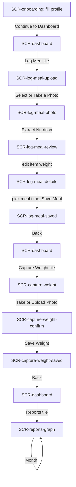
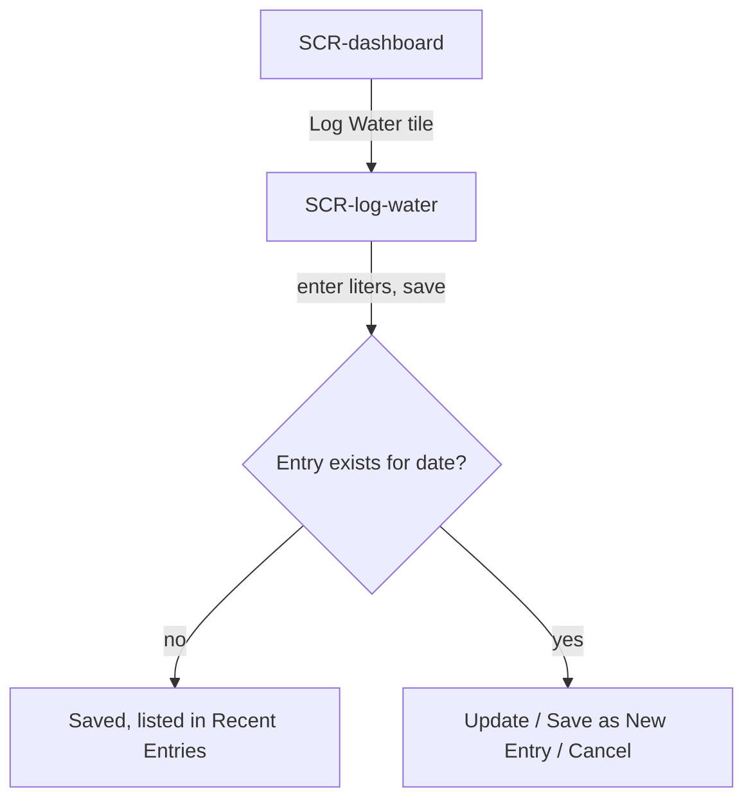
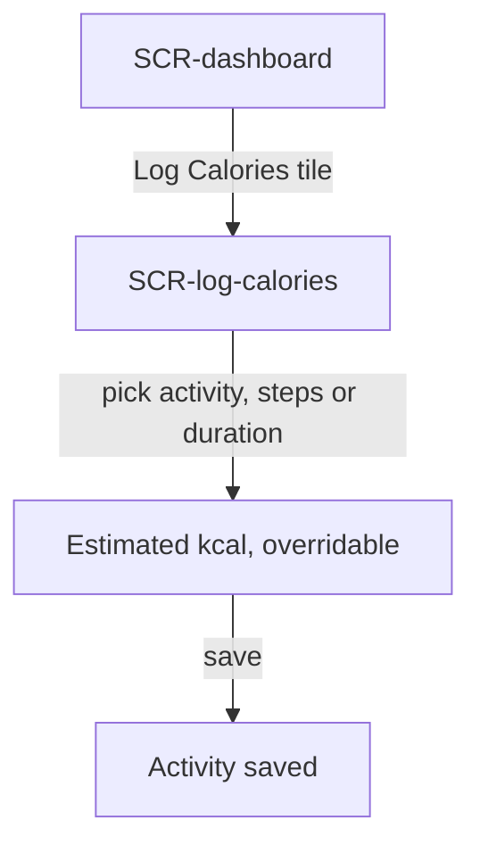

# Spec: Weight Loss Tracker

> Source of truth: the shipped app's source (pages, utils, server routes) and its real screenshots, read only. Labels below are the app's own. Where the brief and the code differ, the code wins and the difference is logged in `issues.md`. Research was skipped for this run; opportunities O1 to O5 come from the research stub (all assumptions from the builder's own use).

## Problem statement
Most weight-loss trackers make logging food the hard part, so people stop within a couple of weeks. Weight Loss Tracker is a mobile-first, installable PWA (390x844 target) that takes the typing out: a meal, a nutrition label or a scale display is read from a photo by Gemini 2.5 Flash. Every AI result is a draft the person reviews and edits before it is saved. Water and activity are logged in a short form, and Reports chart weight against calories in and out.

## Goals / Non-goals
**Goals**
- G1 Log a meal from one photo; AI suggests items, portions and nutrition (O1).
- G2 Keep every AI result editable before saving (O2).
- G3 Show today's calories against a daily target, with BMR as the basis for the target (O3).
- G4 Log weight from a photo of the scale with a confirm step (O4).
- G5 Show weight trend next to calories in and out, by week, month or year (O5).
- G6 For the portfolio video: show the hero flow in about 36 seconds (hard maximum 40).

**Non-goals (out of scope for the mockup and video)**
Sign-up and login screens; admin tools and "view as"; nutrition-label scanning as its own screen; manual meal entry; profile settings; light theme; empty, loading and error states. The real app has these; they are not specified as screens here.

## Success metrics
Product (as designed, none measured in this run):
- Time to log a meal: photo, extract, review, save, without typing a food name.
- Share of AI items saved unedited vs edited (portion, rename, delete) as a signal of draft quality.
- Days per week with at least one meal, one weight and one water entry (logging retention).

Project (this pipeline run):
- Mockup recreates the hero flow screen-per-step with real labels.
- Video length 36 s target, 40 s maximum, covering must-include items 1 to 6.

## Personas
- **Alex, busy adult losing weight** (from research; fictional user in the demo). Goal 78 kg, current about 85.7 kg, about 1,800 kcal daily target. Wants to know "am I under budget today?" without searching food databases for every ingredient.
- **Admin (super admin)**, secondary. Supports users and can "view as" a user, read-only. Out of scope; listed for completeness only.

## Use cases
**UC1 Set up profile and goal**
- Actor: Alex (new user). Trigger: first login, onboarding not completed.
- Main path: Alex picks theme and accent, enters Height (cm), Biological Sex, Date of Birth, Current Weight (kg), Goal Weight (kg) and Goal, then taps "Continue to Dashboard". The profile is saved with onboarding marked complete.
- Alternate: Sex and Date of Birth left blank; BMR cannot be calculated (the app shows a placeholder "Add sex, DOB, height & weight" in profile settings). Save fails; an error banner shows the server message.
- Outcome: the inputs for BMR (Mifflin-St Jeor) exist and the user lands on the Dashboard. Daily calorie target: see Open questions.

**UC2 Log a meal from a photo**
- Actor: Alex. Trigger: Alex has just eaten. Main path: Dashboard, "Log Meal", "Select or Take a Photo", "Extract Nutrition"; the AI returns food name, items with estimated weights, and nutrition totals.
- Alternate: no photo selected and Extract tapped, error "Please select a photo first" (not reachable, the button appears only after a photo); extraction fails, error message shown; "Manual Entry" tab (out of scope).
- Outcome: a draft meal with items, portions and totals.

**UC3 Review, edit and save the meal**
- Actor: Alex. Trigger: AI draft shown. Main path: Alex changes an item's weight (g) and that item's kcal and the macro and micro totals recalculate proportionally; reviews Meal Name, Date, picks "For which meal of the day?", taps "Save Meal".
- Alternate: tap the item name to correct a misidentified item and "Recalculate"; tap the tag icon to scan its label (out of scope as a screen); delete an item; "Discard" with confirm; no items left disables Save.
- Outcome: meal saved under the chosen meal time; success message "Meal logged successfully!".

**UC4 Check today's calorie budget**
- Actor: Alex. Trigger: meal saved. Main path: the "Today's Calorie Budget" card on Log Meal shows Consumed, Target and Remaining with a progress bar; "Meals on Tue, Oct 20, 2026" lists meals grouped by time with an accumulated total per group.
- Alternate: over target shows "+N" and "Over Budget". Card is hidden when no target is set.
- Outcome: Alex sees how much of the day's budget is used.

**UC5 Capture weight from the scale**
- Actor: Alex. Trigger: stepped off the scale. Main path: Dashboard, "Capture Weight", "Take or Upload Photo"; app reads the display ("Reading your scale..."), shows "Confirm the reading" with Weight (kg) and optional BMR (kcal); Alex taps "Save Weight".
- Alternate: low confidence shows a warning; Alex edits the value; "Discard" or "Retake"; "Capture Another" after saving.
- Outcome: weight logged for today with the time shown.

**UC6 See the trend in Reports**
- Actor: Alex. Trigger: wants to know if it is working. Main path: Dashboard, "Reports"; Graph tab; range Week / Month / Year; Target Weight and Latest Weight pills; weight line with Calorie Intake and Calories Burnt bars.
- Alternate: Nutrition, Tabular, Meals tabs; toggle series; tap a point or bar to see that day's diet.
- Outcome: weight trend read against calories in and out.

**UC7 Log water**
- Actor: Alex. Main path: Dashboard, "Log Water", enter Quantity (liters) for a date, save. Alternate: an entry for that date already exists, so Alex chooses "Update to N L", "Save as New Entry" or "Cancel". Outcome: water entry saved; recent entries (last 4 days) listed.

**UC8 Log activity**
- Actor: Alex. Main path: Dashboard, "Log Calories", pick an activity (Walking, Gym, Running, Cycling, Swimming, Pilates, Yoga), enter steps or duration and intensity (Light, Moderate, Vigorous); calories burned is estimated and can be overridden; save. Outcome: calories burnt recorded for the day, used in Reports.

## Key functionalities
| ID | Feature | Priority | UC | Opportunity |
|---|---|---|---|---|
| FN1 | Onboarding profile form (Height, Biological Sex, Date of Birth, Current Weight, Goal Weight, Goal) with theme and accent choice | P0 | UC1 | O3 |
| FN2 | BMR from the profile with Mifflin-St Jeor (10w + 6.25h - 5a, +5 male, -161 female) | P0 | UC1 | O3 |
| FN3 | Photo upload on Log Meal ("Step 1: Upload Photo", "Select or Take a Photo") | P0 | UC2 | O1 |
| FN4 | AI extraction of food name, items, estimated weights, macros and micros ("Extract Nutrition") | P0 | UC2 | O1 |
| FN5 | Edit item weight with live proportional recalculation of item kcal and totals | P0 | UC3 | O2 |
| FN6 | Meal details: Meal Name, Date, meal time (Morning, Mid Afternoon, Lunch, Mid Evening, Dinner), Notes, Save Meal / Discard | P0 | UC3 | O2 |
| FN7 | Today's Calorie Budget card (Consumed, Target, Remaining, progress bar) and meals grouped by time with accumulated totals | P0 | UC4 | O3 |
| FN8 | Capture Weight: scale photo, AI reading, "Confirm the reading" (Weight, optional BMR), Save Weight | P0 | UC5 | O4 |
| FN9 | Reports Graph: Week / Month / Year, Target and Latest Weight, weight line vs Calorie Intake and Calories Burnt bars | P0 | UC6 | O5 |
| FN10 | Dashboard hub with tiles (Capture Weight featured, Log Weight, Log Water, Log Meal, Log Calories, Reports, Profile) | P0 | UC2, UC5, UC6 | O1, O4, O5 |
| FN11 | Rename and recalculate a misidentified item; delete an item | P1 | UC3 | O2 |
| FN12 | Log Water (liters, update-or-new when an entry exists) | P1 | UC7 | O3 |
| FN13 | Log Calories (activity, steps or duration and intensity, estimate with override) | P1 | UC8 | O3, O5 |
| FN14 | Reports: Nutrition, Tabular and Meals tabs; tap a day for its diet | P2 | UC6 | O5 |
| FN15 | Item label scan for accurate nutrition | P2 | UC3 | O1 |

## User flows

### Hero flow decision
**F1 is the hero flow.** It runs the brief's must-include items 1 to 6 in one chain that matches how the product is used: set up, log a meal, see the budget, log weight, see the trend. Onboarding is the first step (a single quick beat) instead of a separate flow, because the video audience needs to hear "budget comes from BMR" before the meal and budget screens make sense, and a separate flow would not be mocked up or shown. F2 (water) and F3 (activity) are short and are not mocked up or videoed.

Pacing hint for script: steps marked **quick** are transitions of about 1 s; steps marked **key** carry the narration (about 4 to 5 s each). 7 quick plus 6 key is about 36 s.

### F1 Photo to progress (HERO)
Use cases: UC1, UC2, UC3, UC4, UC5, UC6.

| Step | Screen | User action (element, in words) | System response | Beat |
|---|---|---|---|---|
| F1.S1 | SCR-onboarding | Form is filled with Alex's values (Height 176, Biological Sex Male, Date of Birth, Current Weight, Goal Weight 78, Goal "Lose Weight"). Taps the "Continue to Dashboard" button | Saves the profile (inputs for BMR) and opens the Dashboard | key |
| F1.S2 | SCR-dashboard | Taps the "Log Meal" tile ("Record your meals") | Opens Log Meal | quick |
| F1.S3 | SCR-log-meal-upload | Taps the dashed "Select or Take a Photo" button under "Step 1: Upload Photo" | Photo chosen; shows its preview with a "Remove" control and an "Extract Nutrition" button | quick |
| F1.S4 | SCR-log-meal-photo | Taps the "Extract Nutrition" button | AI analyses the photo ("Analyzing...") and returns the draft with name, items, weights, nutrition | quick |
| F1.S5 | SCR-log-meal-review | Edits the weight (g) number field on one item row (for example the rice) | That item's kcal and the Calories, Protein, Carbs, Fat totals recalculate; items stay editable (tap name to correct, trash to remove) | key |
| F1.S6 | SCR-log-meal-details | Chooses "Lunch" in the "For which meal of the day?" dropdown (options Morning, Mid Afternoon, Lunch, Mid Evening, Dinner), then taps the "Save Meal" button | Saves the meal under that time; the page resets and shows the success message | key |
| F1.S7 | SCR-log-meal-saved | Reads the "Today's Calorie Budget" card (Consumed, Target, Remaining, progress bar), then taps "Back" | Card and "Meals on Tue, Oct 20, 2026" list include the new meal with accumulated totals by meal time; Back returns to the Dashboard | key |
| F1.S8 | SCR-dashboard | Taps the featured "Capture Weight" tile ("Snap your scale, auto-logged for today") | Opens Capture Weight | quick |
| F1.S9 | SCR-capture-weight | Taps the "Take or Upload Photo" button under "Snap a Photo of Your Scale" | Scale photo chosen; app reads the display ("Reading your scale...") and shows the confirm card | quick |
| F1.S10 | SCR-capture-weight-confirm | Checks the "Weight (kg)" field (85.7) and taps the "Save Weight" button | Nothing is logged until this tap; saves weight for today and shows the success message | key |
| F1.S11 | SCR-capture-weight-saved | Taps "Back" | Returns to the Dashboard | quick |
| F1.S12 | SCR-dashboard | Taps the "Reports" tile ("Weight trends and diet correlation") | Opens Reports on the Graph tab | quick |
| F1.S13 | SCR-reports-graph | Taps the "Month" range button (Graph tab selected) | Chart shows weight line against Calorie Intake and Calories Burnt bars for the month; pills show Target Weight 78 kg and Latest Weight 85.7 kg, down 0.3 kg vs previous | key |

Beat count is 13 steps: 7 quick (S2, S3, S4, S8, S9, S11, S12) and 6 key (S1, S5, S6, S7, S10, S13). Script agent may shorten quick steps to a cut.

Hero-flow data (from the brief; numbers not given in the brief are the mockup agent's to set, kept internally consistent, and tagged as sample data): user Alex; Tuesday, October 20; goal 78 kg; latest 85.7 kg; target 1,800 kcal. The meal logged in the flow is "Chicken rice bowl" at Lunch. The other sample meals (Greek yogurt & berries at Morning, Apple & almonds, Salmon, quinoa & greens) may appear in the Meals list; the real screenshot shows Greek yogurt & berries at 327 kcal, 23.6 g protein, 38 g carbs, 9.3 g fat.

### F2 Log water (secondary, not mocked up)
Use case: UC7.

| Step | Screen | User action | System response |
|---|---|---|---|
| F2.S1 | SCR-dashboard | Taps the "Log Water" tile | Opens Log Water |
| F2.S2 | SCR-log-water | Enters "Quantity (liters)" and saves | Saves the entry and lists it under "Recent Entries (last 4 days)"; if one exists for the date, asks to update or save as new |

### F3 Log activity (secondary, not mocked up)
Use case: UC8.

| Step | Screen | User action | System response |
|---|---|---|---|
| F3.S1 | SCR-dashboard | Taps the "Log Calories" tile ("Log exercise & calories burned") | Opens Log Calories |
| F3.S2 | SCR-log-calories | Picks an activity, enters steps or duration and intensity, adjusts calories if needed, saves | Estimates calories burned (steps about 0.04 kcal per step scaled to weight; MET x weight x hours otherwise) and saves the activity |

## Screen inventory
Hero-flow screens (mockup required, default state only, one screen per step). Where one real page has several visual stages, each stage is its own screen ID.

| ID | Real page | Purpose | Key content | States |
|---|---|---|---|---|
| SCR-onboarding | Onboarding | One-time profile setup | Title "Complete Your Profile", subtitle "Help us understand your weight loss goals"; "How do you want it to look?" with "Morning Momentum" (Light) and "Night Training" (Dark, selected); Accent color swatches (yellow selected); fields Height (cm), Biological Sex, Date of Birth, Current Weight (kg), Goal Weight (kg), Goal; button "Continue to Dashboard"; footer "You're almost there! Just a few more details to get started." | default |
| SCR-dashboard | Dashboard | Hub | Hero card with "Tuesday, October 20" eyebrow and "Keep the momentum, Alex." plus Logout; tiles Capture Weight (featured), Log Weight, Log Water, Log Meal, Log Calories, Reports, Profile with their descriptions | default |
| SCR-log-meal-upload | LogMeal | Start a meal entry | Header "Back" and "Log Meal"; card "Add Meal Entry"; toggle "Photo" (active) / "Manual Entry"; "Step 1: Upload Photo"; button "Select or Take a Photo"; below, the "Meals on Tue, Oct 20, 2026" list (Greek yogurt & berries under Morning) | default |
| SCR-log-meal-photo | LogMeal | Photo chosen, ready to analyse | As above plus the meal photo preview with "Remove", and the "Extract Nutrition" button (robot icon). Photo is a CSS/SVG or inline illustration of a chicken rice bowl | default |
| SCR-log-meal-review | LogMeal | Review the AI draft | "Step 2: Nutrition Information"; Food name; "Food Items (edit weight to recalculate)" rows, each with a name (pencil icon, tap to correct), weight (g) field, kcal, tag (scan label) and trash icons, plus a source badge (AI); hint about the tag icon; "Macronutrients (Total)" Calories, Protein, Carbs, Fat (and Saturated Fat, Fiber, Sugar); "Micronutrients (Total)" | default |
| SCR-log-meal-details | LogMeal | Name, time and save | "Step 3: Meal Details"; Meal Name, Date, "For which meal of the day?" (Lunch), Notes (optional); buttons "Discard" and "Save Meal" | default |
| SCR-log-meal-saved | LogMeal | Confirm save and show the budget | Success banner "Meal logged successfully!"; form back to Step 1; "Today's Calorie Budget" card: Consumed, Target (1,800), Remaining with progress bar; "Meals on Tue, Oct 20, 2026" grouped by meal time with "Accumulated total" per group | default |
| SCR-capture-weight | CaptureWeight | Start a scale capture | Header "Back" and "Capture Weight"; "Snap a Photo of Your Scale"; subtitle "Take a photo of your weighing scale display and we'll read it. You can review and confirm before it's logged."; button "Take or Upload Photo" | default |
| SCR-capture-weight-confirm | CaptureWeight | Confirm the AI reading | Scale photo preview (illustration of a scale display) with "Retake"; card "Confirm the reading"; "Weight (kg)" 85.7; "BMR (optional, kcal)" with placeholder "If shown on scale"; buttons "Discard" and "Save Weight" | default |
| SCR-capture-weight-saved | CaptureWeight | Weight logged | Success "Weight logged: 85.7 kg" with time; button "Capture Another"; scale photo | default |
| SCR-reports-graph | Reports | Trend vs calories | Header "Back" and "Reports"; tabs Graph (active), Nutrition, Tabular, Meals; range Week / Month (active) / Year; pills "Target Weight 78 kg" and "Latest Weight 85.7 kg, 0.3 kg vs previous" (down); series chips Weight, Calorie Intake, Calories Burnt; combo chart (weight line with a dashed target line at 78 kg, orange intake bars, green burnt bars; weight axis left, calories axis right); legend Lost weight / Gained weight; hint "Click a point/bar to see that day's diet" | default |

Secondary screens (not mocked up):

| ID | Real page | Purpose | Key content | States |
|---|---|---|---|---|
| SCR-log-water | LogWater | Record water | "Add Water Intake", Date, "Quantity (liters)", Notes (optional), save; existing-entry choice (Update to N L / Save as New Entry / Cancel); "Recent Entries (last 4 days)" | default, existing-entry prompt |
| SCR-log-calories | LogCalories | Record activity | "Add Activity", activity buttons (Walking, Gym, Running, Cycling, Swimming, Pilates, Yoga), Date, Step count or Duration and Intensity, calories burned with recalculate links, Notes, save, recent list | default |

## Edge cases & error handling
- No photo, Extract: button only appears after a photo; otherwise "Please select a photo first".
- Extraction fails (network, AI error): error banner with server message; the photo stays so Alex can retry. AI reads imperfectly, which is why every result is editable.
- Item misidentified: tap name, type the correct name, "Recalculate" re-pulls nutrition at the current weight.
- Item weight blank or zero: calories for that item scale to 0; scanning a label or recalculating requires a valid weight.
- All items deleted: warning "No items left - add more items or discard this entry."; Save Meal disabled.
- Discard: confirm dialog "Discard this meal entry? Nothing will be saved."
- Meal over budget: Remaining becomes "+N Over Budget" with a red-state bar; no target set hides the card.
- Scale read low confidence: warning "Low confidence reading - please double-check the weight below."
- Invalid weight on save (blank, 0 or negative): "Please enter a valid weight"; field allows 20 to 500 kg.
- Scale photo read fails: error "Failed to read weight from photo", back to the idle state.
- Discard reading: confirm "Discard this reading? Nothing will be saved."
- BMR cannot be calculated (missing weight, height, age or sex): placeholder instead of a number.
- Water entry exists for the date: choice to update, save as new, or cancel.
- Reports with no entries in a period: "No entries in this period yet."
- Photos are stored on the device (IndexedDB) when available; a web-only notice shows where it is not.

Mockup scope: only default states of the hero screens are built, per the brief. The cases above describe the real app, not extra screens.

## Open questions
1. **Daily budget derivation.** The brief says onboarding "works out a daily calorie budget from BMR". In the source, the onboarding form only collects the BMR inputs (it shows no BMR or budget), BMR is calculated by `utils/bmr.js` and shown in profile settings ("Current BMR (auto-calculated)"), and "Daily Cal Target (kcal)" is a profile field the user sets. Logged in `issues.md`. Spec states what the code does; the narration should not claim onboarding auto-sets the target unless the owner confirms.
2. **"Eaten vs burned vs target".** The "Today's Calorie Budget" card shows Consumed, Target and Remaining only. Calories burnt appear in Log Calories and in Reports (Calories Burnt bars). Logged in `issues.md`.
3. **Meal times.** The app has five (Morning, Mid Afternoon, Lunch, Mid Evening, Dinner); the brief lists four. Spec follows the app.
4. **"Logged in a tap".** The brief says water and activity are logged in a tap; in the app each is a short form (liters; activity, steps or duration). Spec follows the app; narration of water and activity is not needed in the hero video.
